# sparseVideoTokenizer

A causal, action-conditioned **hierarchical video tokenizer for robot policies**. It adapts the H-Net
idea from Cartesia's "From Tokens to Bytes" posts ([part 1](https://www.cartesia.ai/blog/from-tokens-to-bytes-part-1),
[part 2](https://www.cartesia.ai/blog/from-tokens-to-bytes-part-2)) from bytes to video frames: the model learns
where to cut the stream, instead of using a fixed tokenizer. The goal is to keep **1 hour, and later 1 day, of
video context on one RTX 4090**, with **event-driven sparse compute**: the expensive network runs only when
something new happens.

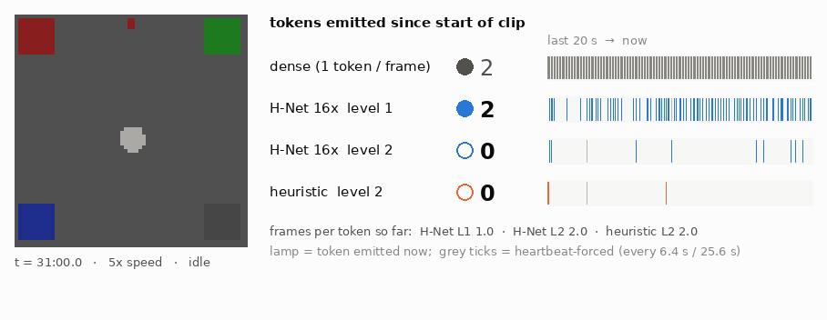

*A held-out robot stream at 5× speed. Counters show tokens emitted so far by a dense tokenizer (one per frame)
vs the learned hierarchy (level 1 and level 2) and the pixel-change heuristic.*

## How it works

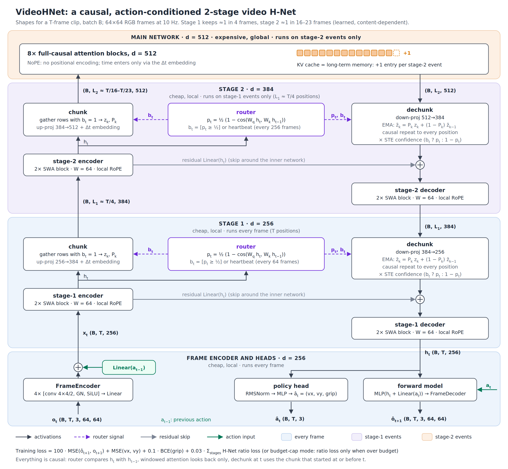

- **Frames are the "bytes".** Each 64×64 frame becomes one 256-d vector, plus an embedding of the previous action.
- **Two learned chunking stages.** Cheap sliding-window layers look at the recent past, and an H-Net router
  (`p_t = ½(1 − cos(W_q h_t, W_k h_{t−1}))`) decides which moments are new. Level 1 keeps about 1 in 4
  frames, and level 2 about 1 in 16–23. A forced *heartbeat* boundary every 64 / 256 frames bounds staleness.
- **The main network** (full causal attention, NoPE + Δt embedding) sees only level-2 tokens. Its KV cache
  is the long-term memory.
- **Back down to frame rate.** The main network's output is dechunked (EMA smoothing, causal repeat, STE)
  and feeds two heads: the **policy** `a_t` and an action-conditioned **forward model** `o_{t+1} | a_t`.
- **Everything is strictly causal**, so the same weights run as a live streaming policy.

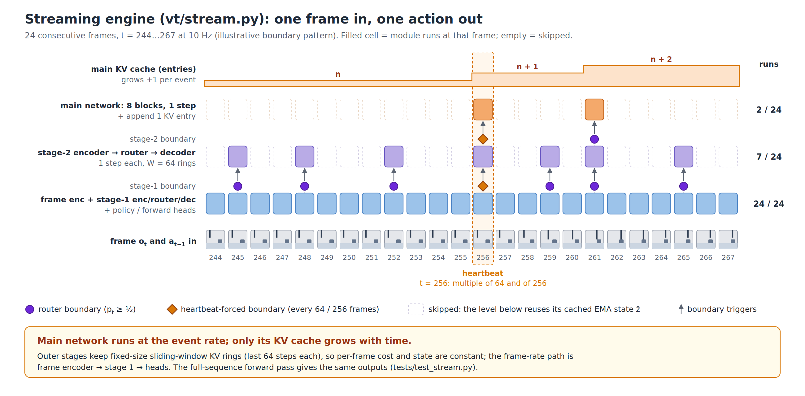

The streaming engine (`vt/stream.py`) runs the frame encoder and level 1 every frame, level 2 only on
level-1 boundaries, and the main network only on level-2 boundaries. It is numerically identical to the
full-sequence model (max error 1.6e-5, identical boundaries).

Text-to-video mapping, and what is new for robots:

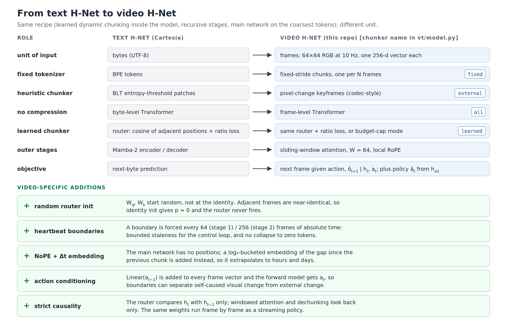

Full explanation: **[docs/how-it-works.md](docs/how-it-works.md)**. Real-scale design and memory budget: **[DESIGN.md](DESIGN.md)**.

## Results so far

All runs use a synthetic long-horizon tabletop stream with ground-truth events, long idle periods,
exogenous light toggles, a blinking LED, sensor noise and a cue→query memory task. The full log, with every
number, is in **[docs/experiment-log.md](docs/experiment-log.md)**.

**Sparse streaming removes the main-network cost.** The frame encoder becomes the new floor.

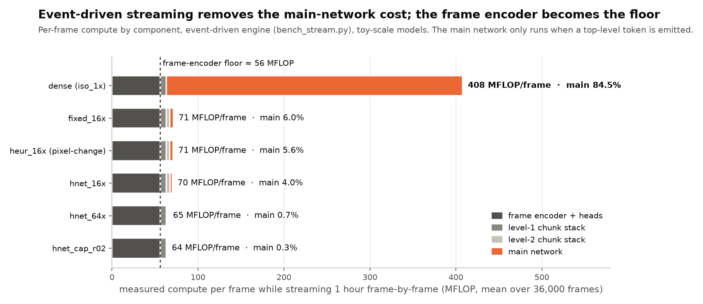

**Memory grows with events, not frames.** Main-network KV after 1 h: 590 MB dense vs 26 MB (16×) vs 2.3 MB (budget cap).

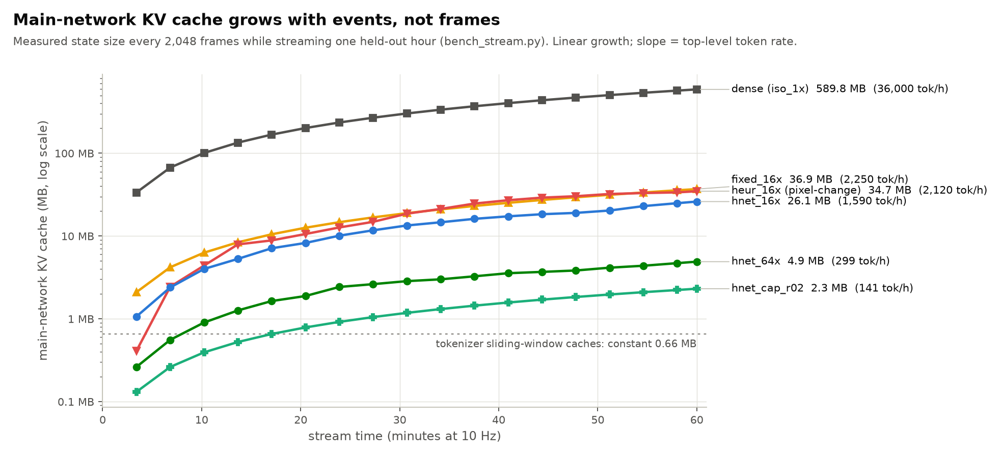

**Real-scale projection for a 680M main network on one 4090.** The per-step timings are measured; the
bars are projections from them. Dense needs 127 GB of KV for a day; event-driven needs 1–6 GB.

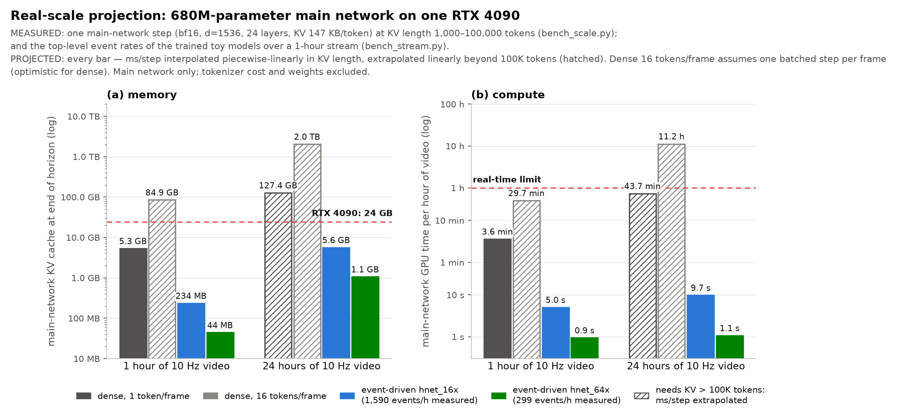

**v1 problems, since fixed** (details in the experiment log):

- **Router stuck at p ≈ 0.5.** Fixed by tying W_q and W_k at init and calibrating the threshold.
- **Memory at chance.** Fixed by storing each event token next to the main output (`--mem_src tok`): held-out hour
  memory went from 52% (v3) to 99% (hnet_v4), against fixed chunking 96% and the pixel-change heuristic 78%.

**Why H-Net's router gets little signal here.** Removing the main network costs only 0.03 dB of next-frame PSNR,
because the local stages solve the dense loss.

**v2: sparse spatio-temporal tokenizer with a fovea** ([docs/v2-spatiotemporal.md](docs/v2-spatiotemporal.md)).
Cells are routed per frame and a learned fovea picks the few cells that get high resolution. It runs on a testbed
built to test each assumption: a tunnel (object permanence), glyphs visible only at high resolution, a rule symbol
flashed minutes before it matters, and a noisy TV.

- **Holds:** about 4 of 64 cells per frame are processed, at 12 vs 150 MFLOP per frame for a dense front end.
- **Holds:** without the fovea the glyph is unreadable (chance).
- **Holds:** a counterfactual task-credit fovea moves high resolution off the noisy TV (49% → 20%) and onto the rule
  symbol (0% → 60%).
- **Not yet:** the main network does not carry content past the local windows. The rule is remembered for about
  600 frames; tunnel exits and hour-long streams are not.


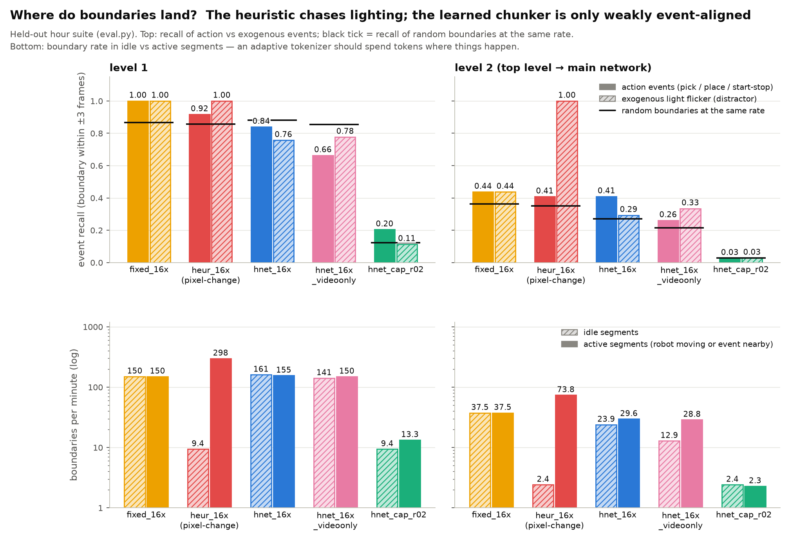

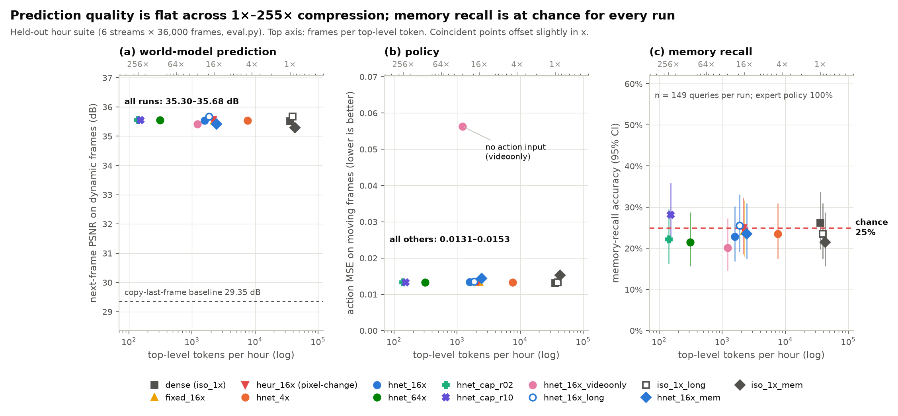

<details>
<summary>More figures: what each tokenizer chose to keep, token rate over an hour, training curves</summary>

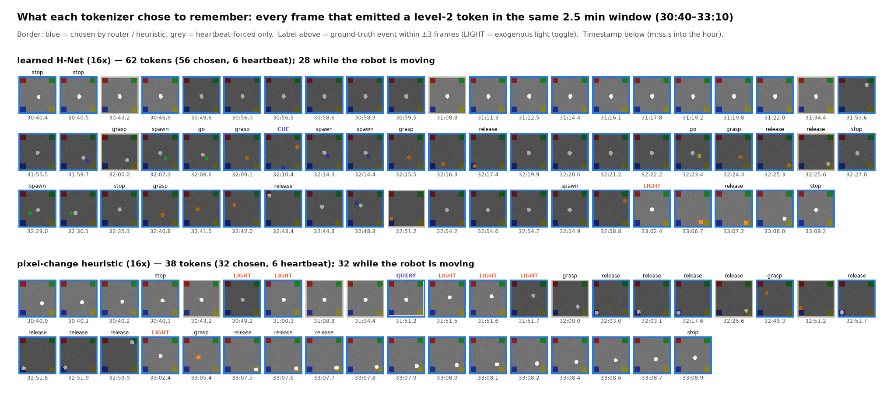


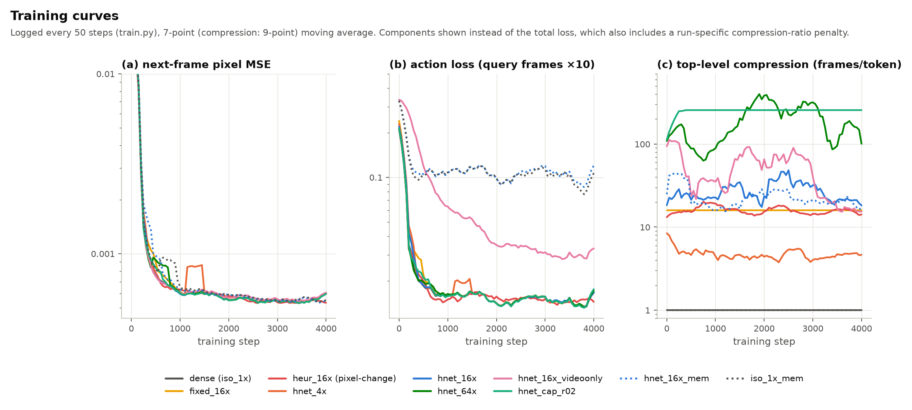

</details>

## What's next

Make the main network matter for the dense loss without wrecking task features: a next-event-token loss on main
alone (`--main_detach`), training on streams long enough to hold several flashes, and an exit-content objective.
Then a learned relevance term for the cell router, and the day-scale L3 stage. Details:
**[docs/future-plans.md](docs/future-plans.md)** and **[docs/v2-spatiotemporal.md](docs/v2-spatiotemporal.md)**.

## Layout

| path | what |
|---|---|
| `vt/env.py` | synthetic long-horizon robot stream with ground-truth events, distractors, memory task; GPU renderer |
| `vt/model.py` | `VideoHNet`: router, ratio / budget-cap loss, heartbeat, chunk/dechunk, sliding-window + full attention |
| `vt/stream.py` | event-driven streaming engine with KV caches and FLOP accounting |
| `train.py`, `eval.py` | training; hour / long-gap / day evaluation in one causal pass |
| `bench_stream.py`, `bench_scale.py` | frame-by-frame streaming benchmark; real-scale main-network latency vs KV length |
| `tests/` | causality test; streaming == full-forward equivalence test |
| `viz/` | figure generators (`arch_diagrams.py`, `behavior.py`, `stream_gif.py`, `results.py`) |
| `docs/` | how it works, experiment log, future plans, figures |
| `run_all.sh`, `followup*.sh` | the experiment queues that produced `runs/` |

## Quickstart

```bash
python3 -m venv .venv && .venv/bin/pip install torch torchvision --index-url https://download.pytorch.org/whl/cu128
.venv/bin/pip install -r requirements.txt
.venv/bin/python train.py --name hnet_16x --chunkers learned,learned --Ns 4,4      # ~11 min on a 4090
.venv/bin/python eval.py hnet_16x --suite hour
.venv/bin/python bench_stream.py hnet_16x --frames 36000
.venv/bin/python tests/test_causal.py && .venv/bin/python tests/test_stream.py hnet_16x
.venv/bin/python viz/results.py        # regenerate result charts from runs/*.json
```
