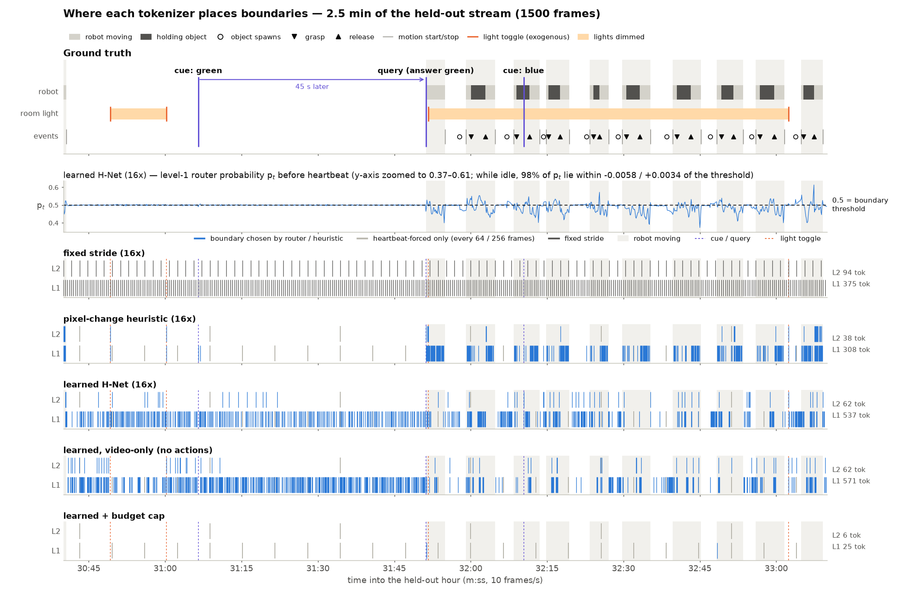
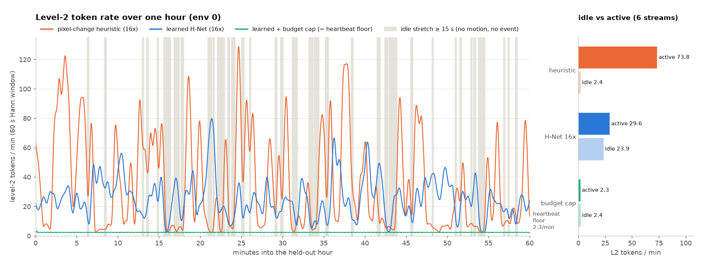

# Experiment log

All runs were on one RTX 4090 (24 GB), torch 2.11 + CUDA 12.8, on 2026-10-29. Raw outputs are in
`runs/<name>/` (`train_log.json`, `eval_*.json`, `stream_36000.json`). `python report.py` regenerates
`runs/report/tables.md`.

## Test bed

`vt/env.py` is a synthetic top-down tabletop. A robot end-effector picks blocks and drops each one in
the bin of its colour. It is rendered at 64×64 and 10 Hz, with ground-truth events. The stream is built
to stress a robot-video tokenizer:

| property | what it tests |
|---|---|
| ~68% idle frames, idle stretches up to 2.5 min | can idle time cost ~0 tokens? |
| ~230 pick-and-place cycles per hour (grasp, release, motion start/stop, spawn) | action events must be tokenized |
| light toggles (~100/h) | exogenous change, not caused by the robot |
| blinking LED (period 16 frames) and pixel noise σ=0.02 | predictable nuisance that a pixel-change heuristic wastes tokens on |
| **memory task**: a colour cue is flashed for 4 frames; later a query flash says "go to that colour's bin" | the correct action depends only on the far past |

The train and test streams use different seeds. The "hour" suite has cue→query gaps of 10 s–2.5 min,
"hour_longgap" has 2.5–40 min, and "day" is one 864,000-frame stream with gaps up to 1 h.

Common training settings:
- **Model:** 40M parameters (2-stage), d = 256 / 384 / 512, 2+2 outer blocks per stage, 8 main blocks, window 64.
- **Optimizer:** 4,000 steps, batch 4 × 2,048 frames, AdamW at lr 6e-4 with cosine decay, bf16.
- **Cost:** about 11 min and 12–14 GB per run.

---

## Step 0: bring-up issues (fixed before any reported run)

| symptom | cause | fix |
|---|---|---|
| OOM at batch 4 × 2,048 | the pixel decoder ran on all 8,192 frames | decode a random 1,536-frame subset per step |
| learned router: zero boundaries (compression = 2,048) | H-Net identity init of W_q, W_k; adjacent frames are near-identical, so cos≈1 and p≈0 | random init, so training starts at p≈0.5 and the ratio loss compresses |
| level-2 compression oscillated between 3× and full collapse | router updates too aggressive; no floor | heartbeat boundaries (64 / 256 frames) and a 0.3× learning rate for the router |
| streaming vs full forward differed by 1e-2 | TF32 convolutions (batched vs single-frame algorithms) | with TF32 off: 1.6e-5, identical boundaries; it is a numerics artefact, not a bug |

## Run v0: first learned model (archived in `runs/_v0`)

- **Dynamics are learned.** Next-frame PSNR on dynamic frames is 36.0 dB vs 29.6 dB for copying the last frame.
- **Memory recall: 22%, at chance (25%).** Only about 1 frame per 2,048-frame clip depends on the cue.
- **Idle tokens are not cheaper.** L2 spends 49 tokens/min idle vs 46/min active. The `target` ratio
  loss enforces an *average* budget above the true event rate (~1,600 events/h), so the spare tokens
  go to the LED and noise.

**Change for all later runs:** training streams use a cue rate of 1/150 (test: 1/600) and a 10× loss
weight on query-onset frames.

---

## E1: chunker comparison at matched ~16× (hour suite, 6 held-out 1-hour streams, one causal pass each)

| run | top frames/token | top tokens/h | idle / active tok/min (L2) | PSNR dyn (copy 29.35) | action MSE (moving) | memory acc (<2.5 min, n=147) | L2 action-event recall | L2 light recall |
|---|---|---|---|---|---|---|---|---|
| iso_1x (dense) | 1 | 36,000 | 600 / 600 | 35.52 | 0.0131 | 26% | 1.00 | 1.00 |
| fixed_16x | 16.0 | 2,250 | 37.5 / 37.5 | 35.53 | 0.0134 | 24% | 0.44 | 0.44 |
| heur_16x | 16.7 | 2,157 | **2.4 / 73.8** | 35.55 | 0.0134 | 25% | 0.41 | **1.00** |
| hnet_16x | 22.7 | 1,594 | 23.9 / 29.6 | 35.54 | 0.0134 | 22% | 0.41 | 0.29 |

- **Prediction quality is identical** at 1× and 16×.
- **The pixel heuristic is highly idle-adaptive,** but it chases exogenous light toggles (100% light recall).
- **The learned router largely ignores the light toggles** (29%), but under the `target` loss it is barely idle-adaptive.
- **At level 1, learned routing recalls 84% of action events,** vs 92% for the heuristic and 100% for fixed-4.
- **Compared with random boundaries at the same rate** (the black ticks in `figures/boundary_quality.png`;
  ±3-frame window):
  - **hnet_16x at L1 is *below* random** (0.84 vs 0.88). At L2 it is above random (0.41 vs 0.27).
  - **The heuristic at L2 barely beats random on action events** (0.41 vs 0.35), but catches every light flicker.
  - **Neither chunker is strongly action-aligned yet.** This is consistent with the objective not rewarding long-range memory (see "Memory diagnostics").

## E2: compression sweep (learned)

| run | L1 frames/token | top frames/token | top tokens/h | PSNR dyn | action MSE | main KV after 1 h |
|---|---|---|---|---|---|---|
| hnet_4x (1 stage) | 4.7 | 4.7 | 7,664 | 35.54 | 0.0133 | 126 MB |
| hnet_16x | 3.8 | 22.7 | 1,594 | 35.54 | 0.0134 | 27 MB |
| hnet_64x | 11.3 | 116.7 | 311 | 35.55 | 0.0133 | 5.7 MB |

Quality is flat across 4.7×–117×, so these metrics don't put a price on compression.

## E3: action causality ablation

`hnet_16x_videoonly` is the same model with **no action input and no policy gradient**; the policy head
is a detached probe.

| | L1 action-event recall | L2 action-event recall | action MSE (probe) | PSNR dyn |
|---|---|---|---|---|
| hnet_16x (action-conditioned) | **0.84** | **0.41** | **0.0134** | 35.54 |
| hnet_16x_videoonly | 0.66 | 0.26 | 0.0563 | 35.41 |

Action conditioning makes boundaries more action-aligned and the representation about 4× better for control.

## E4: long context

**Long-context finetune.** `hnet_16x_long` and `iso_1x_long` were trained for 1,500 more steps on
8,192-frame (13.6 min) clips with gaps up to 10 min. Memory accuracy on the long-gap suite stays near
chance for both (n = 3–7 per bucket, too few to read).

**One-pass 24-hour stream** (864,000 frames, `eval.py --suite day`):

| run | top tokens / day | model-body time | frame-encode time | peak GPU (one-shot pass) | main KV for the day |
|---|---|---|---|---|---|
| hnet_16x_long | 44,840 | 0.73 s | 5.1 s | 14.1 GB | 735 MB |
| hnet_64x | 8,255 | 0.45 s | 4.9 s | 13.7 GB | 136 MB |
| iso_1x_long (dense) | 864,000 | 40.5 s | 4.9 s | 17.7 GB | **14.2 GB** |

The dense model only fits because this toy main network is small (d = 512, 8 layers). At real scale
(below) a dense day doesn't fit.

---

## Streaming engine (frame-by-frame, 1 hour, `bench_stream.py`)

| run | MFLOP/frame | main-net share | top events/h | main KV after 1 h | latency p50 / p99 |
|---|---|---|---|---|---|
| iso_1x | 407.9 | 84.5% | 36,000 | 589.8 MB | 3.3 / 4.5 ms |
| fixed_16x | 71.4 | 6.0% | 2,250 | 36.9 MB | 2.0 / 5.1 ms |
| heur_16x | 71.0 | 5.6% | 2,120 | 34.7 MB | 2.0 / 5.1 ms |
| hnet_16x | 70.2 | 4.0% | 1,590 | 26.1 MB | 2.1 / 5.5 ms |
| hnet_64x | 64.9 | 0.7% | 299 | 4.9 MB | 2.1 / 5.1 ms |
| hnet_cap_r02 | 63.5 | 0.3% | 141 | 2.3 MB | 2.1 / 3.9 ms |

- **Compute:** sparse streaming removes 5.8–6.4× of the per-frame compute. What remains is about 56
  MFLOP/frame of frame encoder, the next target.
- **Latency is launch-bound at this size** (no CUDA graphs yet). All runs are 30–50× faster than the
  10 Hz real-time budget.

**Real-scale main network** (680M parameters, d = 1536, 24 layers, bf16, `bench_scale.py`). One step
costs 3.1 ms at 1K cached tokens, 3.6 ms at 4K, 5.7 ms at 16K, 8.8 ms at 36K and 19.2 ms at 100K
(14.7 GB KV). Event-driven at about 1,600 events/h, that is roughly 5 s of main-network time per hour
of video, vs roughly 216 s if it ran on every frame. A dense day at one token per frame would need 127 GB
of KV cache.

## Budget-cap loss (`--ratio_mode cap`, cap 1/4 per level, rate cost 0.02 or 0.1)

| run | L1 tokens/h | top tokens/h | idle / active tok/min (L1) | PSNR dyn | action MSE |
|---|---|---|---|---|---|
| hnet_cap_r02 | 673 | 141 | 9.4 / 13.3 | 35.56 | 0.0133 |
| hnet_cap_r10 | 570 | 141 | 9.4 / 9.7 | 35.56 | 0.0133 |

- **Idle cost drops to the heartbeat floor,** as intended: 9.4/min at L1 is exactly 600/64.
- **Level 2 collapses to heartbeat-only** (141/h = 36,000/256). Quality doesn't change, because the
  objective doesn't reward long-range tokens.

## Memory diagnostics

1. **Copycat.** At the query frame every model, dense included, outputs about the mean of the 4
   directions, which is the MSE-optimal hedge. One frame later it is exact, because it copies
   `a_{t−1}`. Only one frame per query needs memory.
2. **Anti-copycat attempt.** 30% action-input dropout and a 100× weight on decision frames. On the hour
   suite (n = 147), recall stayed at chance: `hnet_16x_mem` 23%, `iso_1x_mem` 21%. Action MSE got slightly
   worse (0.0144 and 0.0153).
3. **Linear probes of the cue colour.** One sample per cue episode, a train/test split *grouped by
   episode*, and 5 random splits (190 episodes):

   | representation | hnet_16x | iso_1x | chance |
   |---|---|---|---|
   | frame latent at the cue | 96% ± 2 | 96% ± 2 | 25% |
   | `h_t` 50 frames after the cue | 24% ± 8 | 20% ± 5 | 25% |
   | `h_t` 300 frames after | 25% ± 4 | 24% ± 1 | 25% |
   | `h_t` 1,000 frames after | 30% ± 8 | 26% ± 4 | 25% |

   - **A correction.** A first version of this probe used a random per-frame split and reported 71% at
     300 frames. That was leakage: the 4 near-identical frames of one cue landed in both train and test.
   - **Conclusion:** the frame encoder sees the cue, but **neither model keeps it, even for 5 s**. Nothing
     in the objective pays for remembering it: after the cue disappears, only a single decision frame per
     query depends on it. So memory has to be *made to pay* by the objective; see [future-plans.md](future-plans.md) §1.

## Router diagnosis: the learned router has barely learned (from `viz/behavior.py`)

**Level 1 (hnet_16x).** The router probability `p_t` is pinned at the 0.5 threshold.
- While idle, the median |p_t − 0.5| is 0.0026, and 83% of idle frames (10-min window) lie within ±0.006. It only swings to about 0.37–0.61
  while the robot moves.
- |p_t − 0.5| separates moving from idle frames well (AUC ≈ 0.90), but with no consistent sign, so the 0.5
  threshold cuts straight through the signal.
- Boundaries are therefore close to coin flips. It fires on about 23% of idle frames: 140 tokens/min
  idle vs 151 active.
- Event recall equals that of random boundaries at the same rate (≈0.86 vs 0.86).
- It isn't driven by sensor noise: reseeding the noise keeps 70% of boundaries, and `p` stays at
  correlation 0.996. Instead it drifts slowly with the static scene.

**Level 2.** `p` is also ≈0.5 (10–90% range 0.4987–0.5002). It is mildly adaptive (19.6 vs 27.9 router
tokens/min) and modestly above chance on events (0.40 vs 0.25).

**Likely cause: our own fix from Step 0.** With `W_q` and `W_k` randomly initialised *independently*, q
and k are near-orthogonal, so cos ≈ 0 and p ≈ 0.5 whatever the content. The ratio loss can be met by tiny
drifts around the threshold, so the router never has to learn what "change" means. The identity init
failed the other way (p ≈ 0). The fix needs a router that is *sensitive at init* but not saturated:
- tie `W_k = W_q` at init and add a learned temperature or offset on the cosine; or
- route on the *difference* `h_t − h_{t−1}` with a normalised score.

This is now the first item in [future-plans.md](future-plans.md).

**The pixel-change heuristic, for comparison:**
- It is genuinely idle-adaptive (heartbeats only while idle: 2.4/min vs 73.8 active).
- But it fires on 100% of the exogenous light toggles, never catches a cue flash at level 2, and bursts
  about 12 L2 tokens on a single return-from-bin motion.

## v3–v4: making memory learn (temporal model, `vt/model.py`)

v3 (tied router, calibrated threshold, ALiBi, memory read) scored **52%** on held-out hour memory queries (n = 147;
chance 25%), against fixed 94% and isotropic 100% on training memory. Three diagnoses, each measured:

1. **Main outputs overwrite the event.** A linear probe of the main network's output at the first token after the
   cue read the cue at 18% (fixed) and 54% (hnet). The output is a contextualised mix, not the event itself.
2. **The memory read could only relay.** It read main outputs, so it could only return what main had already kept.
3. **Content-adaptive chunking breaks the relay.** The tokens entering main still carried the cue at +50 / +200
   frames with fixed chunking (0.89), but not with learned chunking (0.46 / 0.50): learned boundaries move with content.

**Fix (`--mem_src tok`):** memory entries are `[RMSNorm(main input token), main output]`. The input token is the
event as it happened; the output is its context. `MainNet` keeps both (`self.last`), and the streaming engine
appends the same entry.

| run (held-out hour, n = 147 queries) | memory acc | dynamic PSNR | action MSE |
|---|---|---|---|
| hnet_v3 | 52% | 35.36 | 0.013 |
| **hnet_v4** (`mem_src tok`) | **99%** | 35.46 | 0.011 |
| hnet_v4d (`--router_detach`) | 100% | 35.51 | 0.012 |
| fixed_v4 | 96% | 35.70 | 0.011 |
| heur_v4 | 78% | 35.54 | 0.012 |
| iso_v4 | eval OOM (full attention + ALiBi bias over 36K frames) | | |

- **Long gaps** (1.5k–24k frames, `hour_longgap`) stay at chance for every model, but there are only 13 queries.
  `--freeze_fenc` long-gap fine-tuning (fixed_v5, hnet_v5) is the next test.
- **`--router_detach`** (the ratio loss no longer shapes the encoder) did not make the L2 router learn: its AUC for
  action events stays 0.50–0.55, while the L1 state change alone gives 0.86 and the L2 input 0.76.

## Why the H-Net router learns on text but not on this video stream

**Main-network ablation** (hnet_v4, held-out hour): removing main costs **0.03 dB** of next-frame PSNR (35.13 → 35.10)
and raises action MSE from 0.0115 to 0.0148. Memory drops from 100% to 29%.

So on this stream the dense loss is solved by the local stages. On text, next-byte loss *needs* the main network
(words, syntax), so a boundary placed badly costs loss and the router gets a gradient. Here:

- **no gradient signal:** where L2 cuts barely changes the dense loss;
- **the L2 input is already a sequence of change points:** the router's "adjacent tokens are dissimilar → cut"
  assumption, which works for bytes, has little left to find after L1;
- **sparse credit:** only the rare query frames depend on long memory.

This motivated v2 (`docs/v2-spatiotemporal.md`): a testbed where the dense loss does depend on long memory, and a
front end that is sparse in space as well as time.
